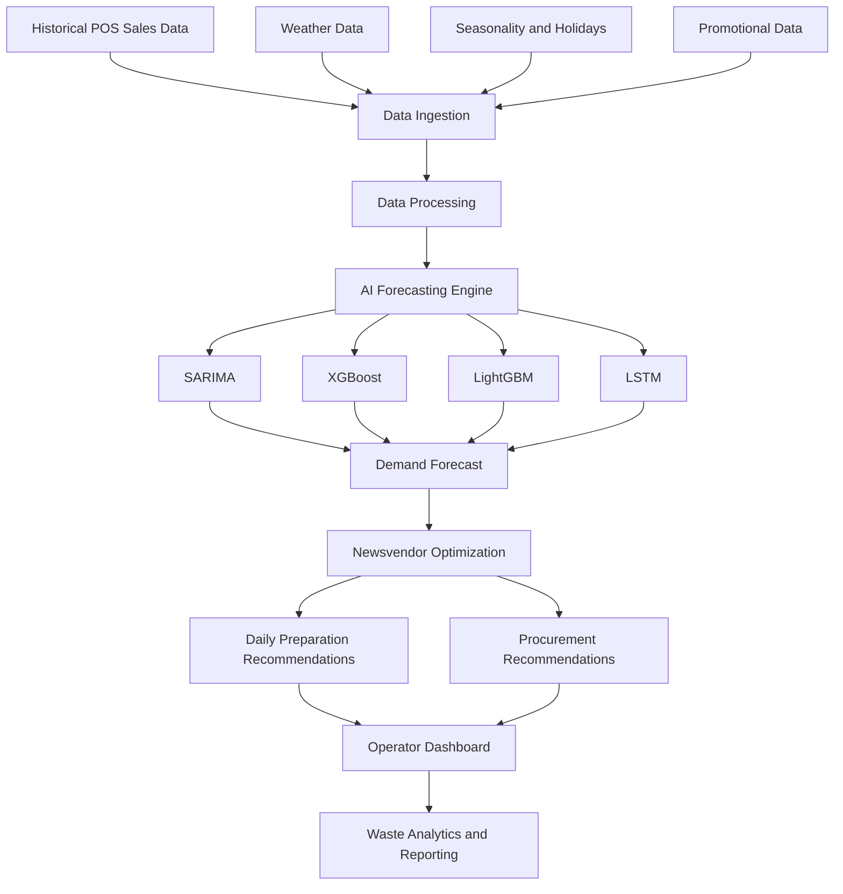
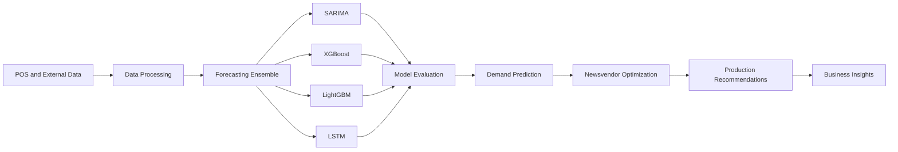
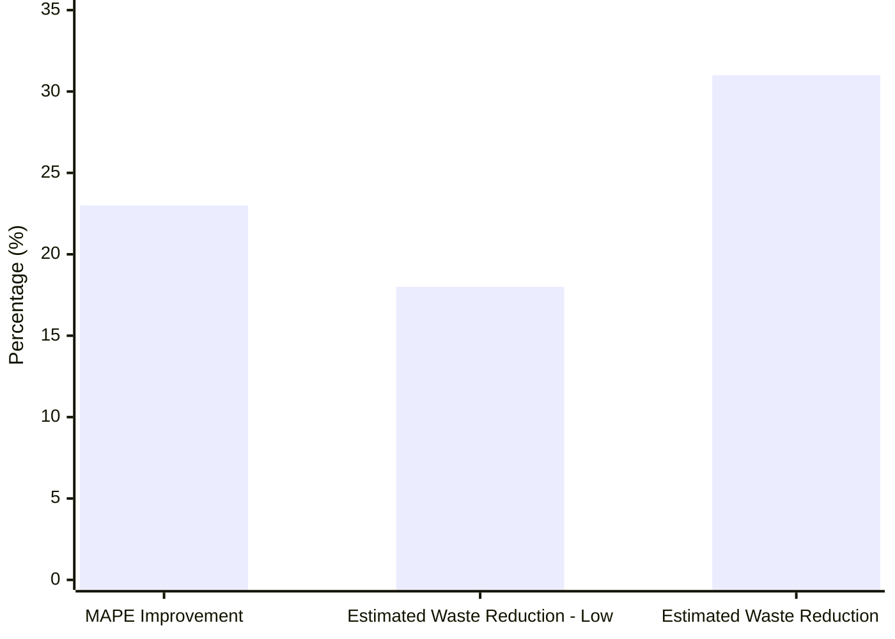
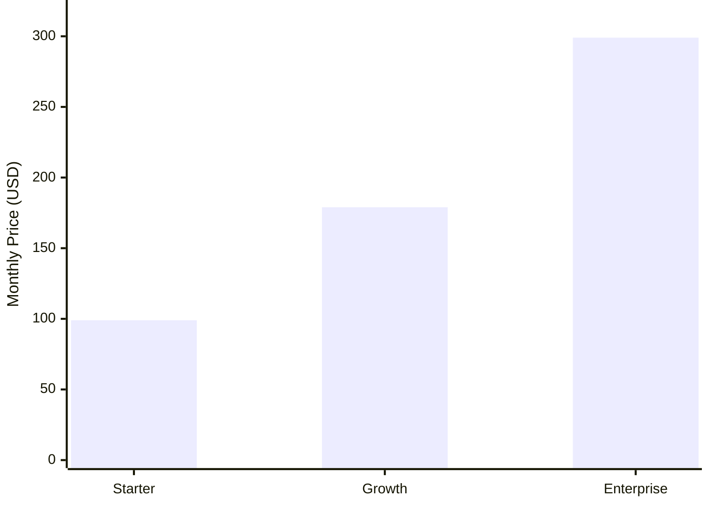
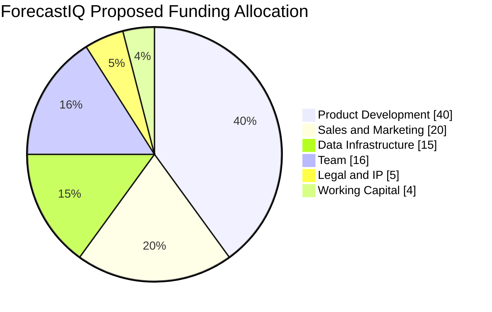
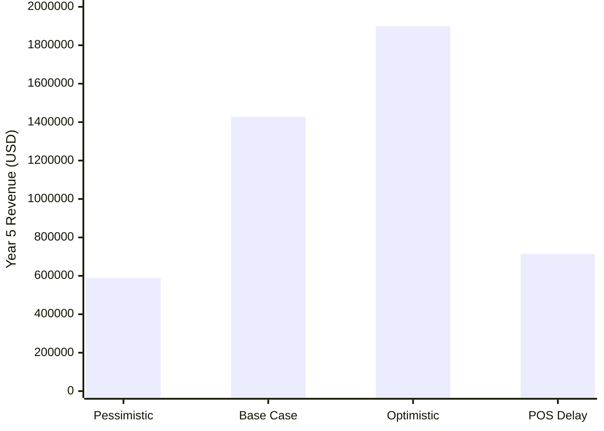

# FORECASTIQ
## AI-Driven Food Demand Forecasting and Production Optimization

**Master's Capstone Business Plan | Business Analytics and Data Science**

ForecastIQ is an AI-driven Software-as-a-Service (SaaS) business concept designed to help Quick Service Restaurants (QSRs), cloud kitchens, and food-service operators forecast customer demand, optimize food production, and reduce food waste.

By combining historical sales data, weather conditions, seasonality, holidays, and promotional activities with machine learning models, ForecastIQ aims to provide daily, item-level demand forecasts and intelligent production and procurement recommendations.

---

## 1. Project Overview

Food-service businesses frequently rely on manual estimates and intuition when planning daily food production. This can result in overproduction, food waste, stock-outs, and reduced profitability.

ForecastIQ proposes an integrated AI forecasting and production optimization platform that helps food-service operators make data-driven operational decisions.

### Main Objectives

- Forecast customer demand at individual menu-item level.
- Optimize daily food preparation quantities.
- Reduce unnecessary food production and waste.
- Improve procurement and inventory planning.
- Minimize stock-outs while maintaining service levels.
- Provide automated waste analytics and reporting.
- Support sustainable and profitable food-service operations.

## 2. ForecastIQ System Workflow

The proposed platform follows this workflow:

## 3. Technology and Machine Learning Approach

ForecastIQ proposes a multi-model forecasting ensemble to capture different demand patterns and external influencing factors.

| Technology / Model | Purpose |
|---|---|
| Python | Data processing and machine learning |
| SARIMA | Time-series forecasting |
| XGBoost | Predictive demand modelling |
| LightGBM | Gradient boosting and demand prediction |
| LSTM | Sequential demand pattern modelling |
| AWS | Cloud infrastructure |
| MLflow | Machine learning model management |
| Kubernetes | Deployment orchestration |
| REST APIs | POS system integration |

### Machine Learning Architecture

### Proposed POS Integrations

The business plan identifies the following POS platforms as potential integration partners:

- Posist
- Petpooja
- Gofrugal

The proposed system combines POS sales data with external demand signals to generate actionable recommendations.

## 4. Proof of Concept and Results

A technical proof of concept was developed using anonymised historical sales data from a partner cloud kitchen in H2 2024.

The forecasting results were compared against the operator's existing moving-average baseline.

### Key Reported Results

| Performance Metric | Result |
|---|---:|
| Forecast accuracy improvement (MAPE) | Approximately 23% |
| Estimated food-waste reduction | 18–31% |

### Results Visualization

**Note:** These are early-stage proof-of-concept results reported in the business plan. The estimated waste reduction varies by product category and requires further validation through commercial pilots.

## 5. Business Model

ForecastIQ follows a subscription-based SaaS business model targeting small and medium-sized food-service operators in India.

### Target Customers

**Primary market:**
- Independent QSR operators.
- Cloud kitchen owners.
- Small and medium-sized restaurant businesses.
- Operators managing approximately 2–10 outlets.

**Secondary market:**
- Regional fast-food chains.
- Multi-location food-service businesses.
- Corporate and institutional catering operators.

### SaaS Subscription Pricing

| Subscription Plan | Proposed Monthly Price |
|---|---:|
| Starter | $99 / outlet |
| Growth | $179 / outlet |
| Enterprise | $299 / outlet |

### Pricing Visualization

The business plan estimates:

- Blended Average Revenue Per User (ARPU): $140 per outlet/month.
- Steady-state gross margin: 72%.
- Monthly customer churn assumption: 3%.

## 6. Proposed Funding Allocation

The business plan proposes an initial funding requirement of **$320,000 over 18 months**.

### Funding Breakdown

| Funding Category | Allocation | Amount |
|---|---:|---:|
| Product Development | 40% | $128,000 |
| Sales and Marketing | 20% | $64,000 |
| Data Infrastructure | 15% | $48,000 |
| Team | 16% | $51,200 |
| Legal / IP | 5% | $16,000 |
| Working Capital | 4% | $12,800 |
| **Total** | **100%** | **$320,000** |

### Funding Allocation Visualization

## 7. Financial Projections

The financial model estimates revenue growth based on outlet acquisition, subscription pricing, and customer retention assumptions.

### Base-Case Financial Projections

| Financial Metric | Business Plan Projection |
|---|---:|
| Year 1 Revenue | $58,800 |
| Year 1 Active Outlets | 35 |
| Year 5 Revenue | $1,428,000 |
| Year 5 Active Outlets | 850 |
| Expected Break-Even | Month 17 |
| Active Outlets at Break-Even | 101 |
| Monthly Recurring Revenue at Break-Even | $14,200 |

### Year 5 Revenue Scenario Analysis

The business plan considers four financial scenarios.

| Scenario | Year 5 Revenue |
|---|---:|
| Pessimistic | $588,000 |
| Base Case | $1,428,000 |
| Optimistic | $1,900,000 |
| POS Integration Delay | $714,000 |

**Important:** All financial figures are business-plan estimates and projections. They are not actual achieved commercial revenue or operating results.

## 8. Market and Competitive Positioning

ForecastIQ is positioned as an affordable AI-powered demand forecasting and production optimization solution for Indian SME food-service operators.

The business plan compares the proposed solution with enterprise analytics platforms and existing POS-based reporting solutions.

### Competitive Differentiation

- Item-level demand forecasting.
- Integration of multiple demand signals.
- Production quantity recommendations.
- Food-waste analytics.
- Affordable monthly SaaS subscription tiers.
- Potential integrations with existing Indian POS platforms.

## 9. Business Strategy and Research Frameworks

The business plan applies established business and strategic analysis frameworks, including:

- PESTLE Analysis.
- SWOT Analysis.
- Porter's Five Forces.
- Value Proposition Canvas.
- Business Model Canvas.
- TAM, SAM and SOM market analysis.
- VRIO Analysis.
- Balanced Scorecard.
- Financial Scenario and Sensitivity Analysis.

These frameworks support market evaluation, competitive positioning, operational planning, and financial decision-making.

## 10. Project Information

| Detail | Information |
|---|---|
| Project Name | ForecastIQ |
| Author | Manoj Kumar Leburu |
| Programme | Master's in Business Analytics and Data Science |
| Institution | EU Business School |
| Promoter | Prof. MANTZEL Kay |
| Submission Date | 15 July 2026 |
| Project Type | Master's Capstone Business Plan |
| Business Model | AI-powered SaaS |

## 11. Business Plan Document

The complete academic business plan is available below.

📄 **[Read the Complete ForecastIQ Business Plan (PDF)](ForecastIQ-Business-Plan.pdf)**

## 12. Project Skills and Knowledge Demonstrated

- Business Analytics
- Data Science
- Predictive Analytics
- Machine Learning
- Time-Series Forecasting
- AI-Based Business Solutions
- Financial Modelling
- Market Research
- Business Strategy
- SaaS Business Model Development
- Business Intelligence
- Operational Optimization

## 13. Disclaimer

This repository presents an academic Master's capstone business plan developed by Manoj Kumar Leburu.

ForecastIQ is presented as a proposed business concept. Market assumptions, proposed technology architecture, pricing, financial projections, and estimated outcomes are included for academic and business-planning purposes.

Proof-of-concept results are reported from the business plan and should not be interpreted as independently verified commercial performance.

---

**Developed by Manoj Kumar Leburu**

*Business Analytics | Data Science | Predictive Analytics | AI-Driven Business Solutions*
