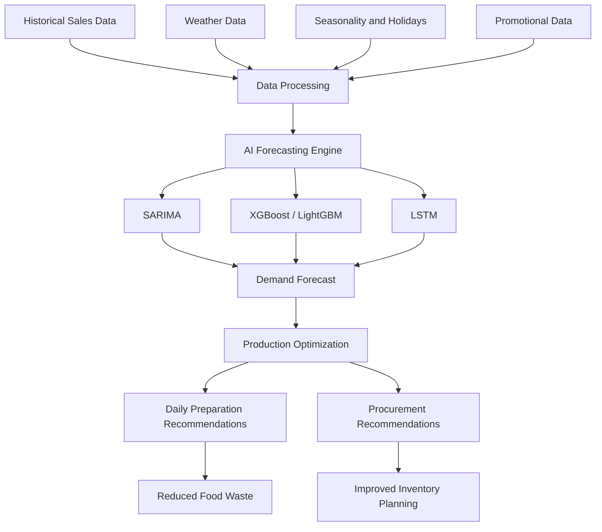
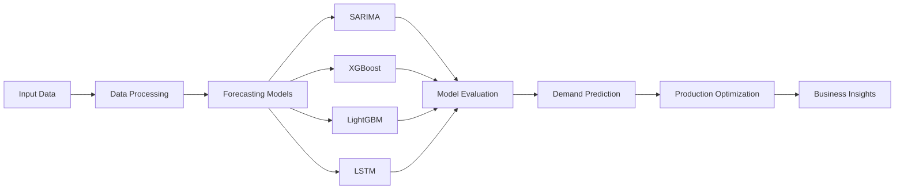
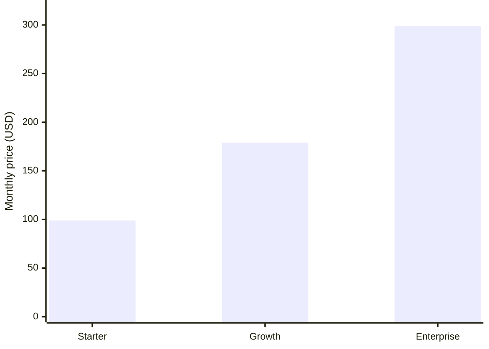

# ForecastIQ – AI-Driven Food Demand Forecasting and Production Optimization

**Master’s Capstone Business Plan | Business Analytics and Data Science**

ForecastIQ is an AI-driven Software-as-a-Service (SaaS) concept designed to help Quick Service Restaurants (QSRs), cloud kitchens, and food-service operators forecast customer demand, optimize food production, and reduce food waste.

The platform uses historical sales data, weather information, seasonality, and promotional activities to generate demand forecasts and daily preparation and procurement recommendations.

## Project Overview

Food-service businesses often rely on intuition and manual estimates when planning daily food production. This can lead to overproduction, food waste, stock-outs, and reduced profitability.

ForecastIQ aims to address this challenge through predictive analytics and machine learning, providing operators with actionable insights to improve operational efficiency and support data-driven decisions.


## System Workflow


## Key Objectives

- Forecast customer demand at individual menu-item level.
- Optimize daily food preparation and production quantities.
- Reduce overproduction and unnecessary food waste.
- Support procurement and inventory planning.
- Minimize stock-outs while maintaining service levels.
- Provide waste analytics and automated reporting.
- Support sustainability and business profitability.

## Technology and Machine Learning Approach

The business plan proposes the following machine learning models and technologies:

| Technology | Purpose |
|---|---|
| SARIMA | Capturing stable temporal demand patterns |
| XGBoost | Modelling demand using multiple variables |
| LightGBM | Predictive demand modelling |
| LSTM | Identifying sequential demand behaviour |
| AWS | Cloud infrastructure and deployment |
| MLflow | Model management |
| Kubernetes | Production orchestration |


### Machine Learning Architecture



## Proof of Concept

The business plan describes a proof of concept developed in H2 2024 using anonymised sales data from a partner cloud kitchen.

The reported results were:

- Approximately 23% improvement in MAPE compared with the operator's moving-average baseline.
- Estimated food-waste reduction of 18–31%, depending on the food-item category.

These figures are results reported in the business plan and are not claims of independently verified commercial performance.


### Key Proof-of-Concept Results

| Performance Metric | Reported Result |
|---|---:|
| Forecast accuracy improvement (MAPE) | 23% |
| Estimated food-waste reduction | 18–31% |

**Note:** These are early-stage results reported in the business plan using anonymised partner cloud-kitchen sales data. They require further validation through commercial pilots.

## Business Model

ForecastIQ follows a subscription-based SaaS pricing model:

| Plan | Proposed Price |
|---|---:|
| Starter | $99 / outlet / month |
| Growth | $179 / outlet / month |
| Enterprise | $299 / outlet / month |

The business plan estimates a blended average revenue per user (ARPU) of $140 per outlet per month and a steady-state gross margin of 72%.


### SaaS Subscription Pricing



*Proposed monthly subscription price per outlet.*
```
## Financial Projections

The following figures are business-plan projections:

| Metric | Projection |
|---|---:|
| Initial funding requirement | $320,000 |
| Year 1 revenue | $58,800 |
| Year 1 active outlets | 35 |
| Year 5 active outlets | 850 |
| Year 5 revenue | $1,428,000 |
| Expected break-even | Month 17 |
| Active outlets at break-even | 101 |

These are proposed financial forecasts, not actual achieved revenue or business performance.

## Project Information

- **Project:** ForecastIQ
- **Author:** Manoj Kumar Leburu
- **Programme:** Master’s in Business Analytics and Data Science
- **Institution:** EU Business School
- **Promoter:** Prof. MANTZEL Kay
- **Submission date:** 15 July 2026
- **Project type:** Master's Capstone Business Plan

## Project Document

The complete business plan is available in this repository:

📄 **[Read the ForecastIQ Business Plan (PDF)](ForecastIQ-Business-Plan.pdf)**

## Disclaimer

This repository presents an academic business plan developed as part of a Master's capstone project. Business models, pricing, market assumptions, financial projections, and estimated outcomes are presented for academic and planning purposes. They should not be interpreted as verified commercial results.

---

**Developed by Manoj Kumar Leburu**  
Business Analytics | Data Science | Predictive Analytics | AI-driven Business Solutions
